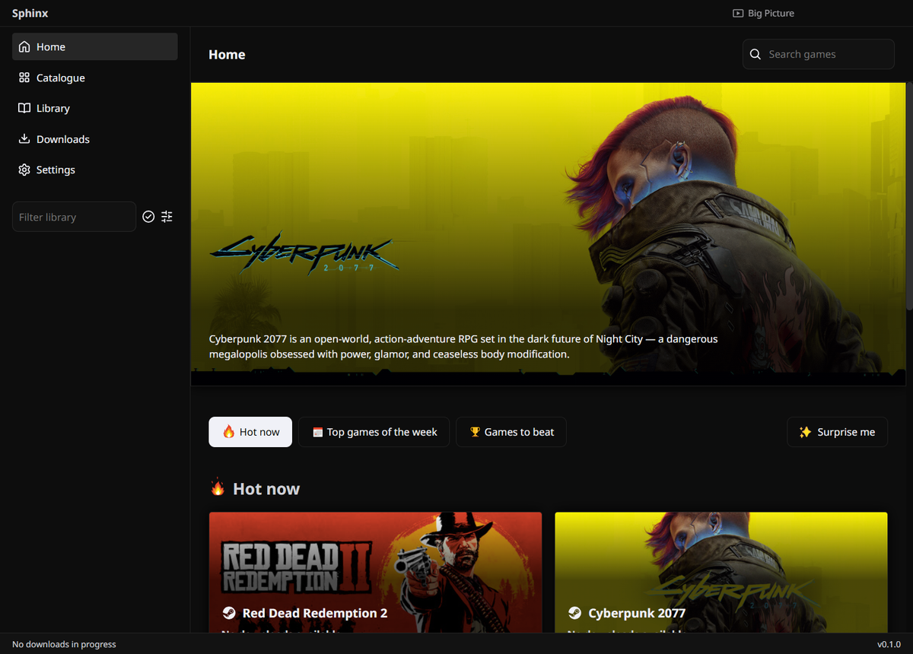
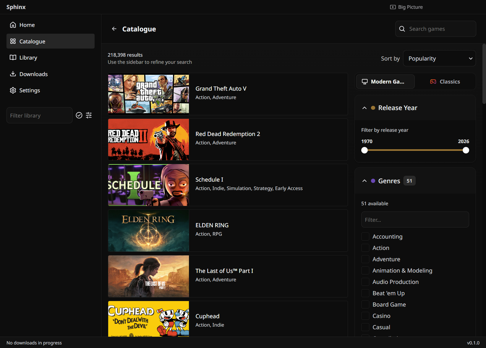
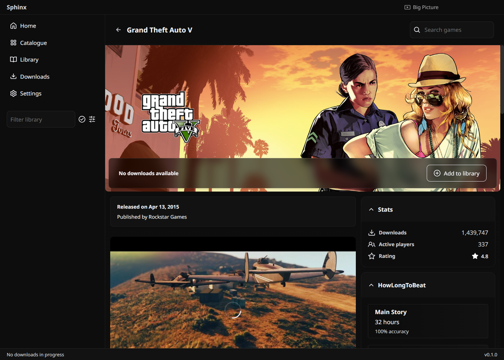
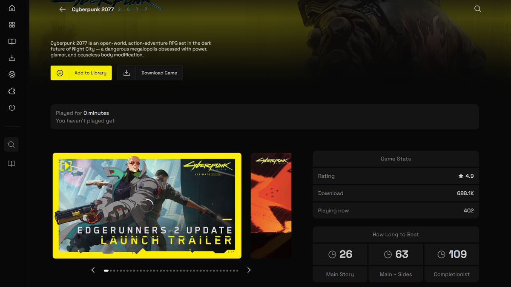
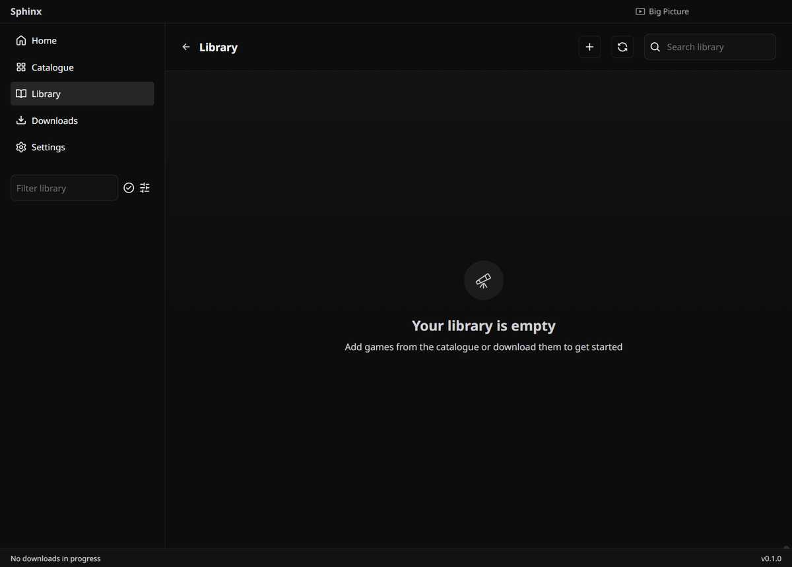

<div align="center">

<picture>
  <source media="(prefers-color-scheme: dark)" srcset="./branding/png/sphinx-symbol-white-1024.png" />
  
</picture>

<h1 align="center">Sphinx Launcher</h1>

<p align="center">
  <strong>A desktop launcher for your game library and downloads. The shell is Rust and Tauri, the application logic runs in a Node.js sidecar, and libtorrent handles the torrents.</strong>
</p>

[](https://github.com/Raka-Mahendra/sphinx/actions/workflows/lint.yml)
[](https://github.com/Raka-Mahendra/sphinx/releases)
[](LICENSE)



</div>

## Alpha 0.1

The [v0.1.0 release](https://github.com/Raka-Mahendra/sphinx/releases/tag/v0.1.0) is the first public build. It runs on Windows x64 and covers the core loop: browse the catalogue, open a game page, add it to your library, and download it. Expect rough edges, and read [Limitations in v1](#limitations-in-v1) before you install.

## About the project

Sphinx Launcher is a desktop app for keeping a game library and downloading games from its catalogue. You search for a title, open its page, add it to your library, and the download runs until the files are on disk. Covers and playtime stay with each library entry, and Big Picture gives you the same catalogue in a full-screen layout you can drive with a controller.

It started as a fork of Hydra Launcher. The interface and the download logic come from there. What changed is the shell: the Electron main process, electron-builder and the bundled Epic and Legendary scripts are gone, replaced by a Rust shell on Tauri v2 that supervises a Node.js sidecar. The torrent engine is still the same libtorrent addon. The repo also keeps the migration notes, the PRD, and the baseline behaviour docs in [`docs/`](./docs) so the rewrite can be checked against what the old build did.

## Install

Download `sphinx-launcher_0.1.0_x64-setup.exe` from [Releases](https://github.com/Raka-Mahendra/sphinx/releases/latest) and run it. The installer is per-user and needs no administrator rights.

The installer is not Authenticode signed. On first run Windows SmartScreen shows "Windows protected your PC"; choose **More info**, then **Run anyway**. That warning is expected for an unsigned publisher, not a sign of damage. See [Windows SmartScreen and code signing](#windows-smartscreen-and-code-signing) if you want to know what signing would change.

The app updates itself from GitHub Releases. An alpha can break between builds, so keep the installer around if you need to roll back.

## What it does

- The library keeps the games you own in one list, with covers and playtime. Removing a game does not touch its files.
- The catalogue shows featured and trending titles and lets you search by name. A game page carries screenshots, a description, the rating, and how long the game takes to beat.
- The download queue runs on the bundled libtorrent engine and survives a restart of the app. Pause, resume, and watch progress in the Downloads page. The engine is tested at the process level, but no public build has downloaded a real torrent yet.
- The sidecar watches running games and adds the minutes to the library entry.
- Big Picture opens a controller-first layout in its own window, with the same catalogue and library.
- The interface ships with more than 30 languages and picks one from the system locale.

## Screenshots

<div align="center">
<table>
  <tr>
    <td width="50%"></td>
    <td width="50%"></td>
  </tr>
  <tr>
    <td width="50%"></td>
    <td width="50%"></td>
  </tr>
</table>
</div>

## Status

What was exercised on Windows 11 with the v0.1.0 build: boot, Home, Catalogue, game pages, add and remove from the library, empty library and downloads states, Settings, and Big Picture in a second window. Torrent downloads have automated tests but no clean-machine run yet. Cloud saves could not be exercised because this build has no OAuth client. Linux has no build in this alpha.

The full inventory, including the parts that are in the tree but unfinished and the parts that are not built at all, is in [`docs/feature-status.md`](./docs/feature-status.md). The short version:

- **Done and exercised:** catalogue, game pages, library, Big Picture, playtime tracking, themes, languages, tray, IPC allowlist.
- **Done in code, not yet run end to end:** torrent downloads (pause, resume, seeding, partial file selection), cloud saves, the installer for the next version, autostart, deep links.
- **Disabled in this build:** every feature that needs Hydra's server, behind five flags, and cloud saves because the binary has no OAuth client.
- **Not built:** local achievements, Epic without Hydra, Linux, macOS, a portable build, and Authenticode signing.

## Build from source

Project notes live in [`docs/`](./docs). Start with [`docs/baseline-behavior.md`](./docs/baseline-behavior.md) for what the app does, [`docs/feature-status.md`](./docs/feature-status.md) for what works today, and [`docs/MIGRATION_LOG.md`](./docs/MIGRATION_LOG.md) for the migration history.

### Requirements

- Node.js 22 and Yarn (the repo uses Corepack)
- Rust toolchain
- Git and a C++ toolchain (Visual Studio C++ Build Tools on Windows, GCC/Clang on Linux, Xcode command-line tools on macOS). The native build fetches CMake and CTest through vcpkg.

`postinstall` builds the Rust native addon (`hydra-native/hydra-native.node`). On Windows x64 and Linux x64 the libtorrent bridge comes prebuilt from `native/torrent-bridge/prebuilt`, so installs skip compiling libtorrent. Other platforms build it from source, and `HYDRA_TORRENT_BRIDGE_FROM_SOURCE=1` forces a source build everywhere. When a push changes `native/torrent-bridge` or `scripts/build-torrent-bridge.cjs`, the "Torrent bridge prebuilts" workflow rebuilds the binaries and commits them to that branch.

### Run it locally

```sh
corepack yarn install          # postinstall builds the native addon
cp .env.example .env           # then set MAIN_VITE_API_URL
corepack yarn dev              # tauri dev: Rust shell + Node sidecar + Vite renderer
```

`.env` is git-ignored and read by `scripts/build-sidecar.mjs`, which replaces `import.meta.env.MAIN_VITE_*` at build time. `MAIN_VITE_API_URL` points at the catalogue API; the other keys in `.env.example` are optional referral and subdomain settings. Leave it empty and the app fails at startup with a `TypeError`, so fill it in first.

The sidecar writes its log next to the app's user data. The IPC allowlist that both Rust and the sidecar enforce is generated by `yarn gen:ipc-allowlist` and checked by `yarn test`.

### Build an installer

```sh
corepack yarn build
```

This stages the Node runtime that Tauri bundles as `externalBin`, checks that `hydra-native.node`, the libtorrent bridge and the VC++ runtime DLLs are present, then runs `tauri build`. The NSIS installer lands in `src-tauri/target/release/bundle/nsis/`.

`check:torrent-resources` fails the build when the torrent engine is missing, so an installer that cannot download anything never ships. Updater artifacts need `TAURI_SIGNING_PRIVATE_KEY`; this project's key is passwordless, so `TAURI_SIGNING_PRIVATE_KEY_PASSWORD` stays unset. `docs/release.md` covers that, Authenticode signing and the clean-machine test plan.

### Releasing

Releases come from tags: `git tag v0.1.0 && git push origin v0.1.0`. The `Tauri Release` workflow builds the installer, creates a draft release with `latest.json` and `SHA256SUMS`, then publishes it. The workflow needs the updater key and the OAuth credentials as repository secrets. Until those exist, build and upload the installer from your machine.

## Limitations in v1

These are deliberate and recorded in the PRD (§2), not bugs:

- **Account-bound features are hidden.** Achievements, Steam connection and sync, friends, chat, profiles, reviews, library and download-source sync, legacy Hydra Cloud subscriptions, Epic/Legendary, and the Decky plugin depend on Hydra's login or server, which Sphinx does not ship.
- **No local achievements.** Achievement definitions come from Hydra's server, so there is nothing to unlock while signed out.
- **Cloud saves are disabled in this build.** The Google OAuth client is embedded at compile time, and this alpha was built without one. The code and tests are in the tree, and a build with `GOOGLE_CLIENT_ID` and `GOOGLE_CLIENT_SECRET` set turns the feature on.
- **The Windows installer is unsigned.** SmartScreen, Smart App Control and Defender may warn.
- **No portable build.** The updater installs and exits on Windows, so "restart" means relaunch after the installer finishes.
- **Playtime can be under-counted if the sidecar crashes** while a game runs. The recovery scan resumes the session, but the gap stays.
- **Windows only.** Linux packaging is planned for a later phase.
- **Some settings are untested.** Debrid, download sources, and emulation have code but no end-to-end test in this build. They are listed in [`docs/feature-status.md`](./docs/feature-status.md).
- Sphinx Launcher is an independent fork and does not follow Hydra Launcher releases; upstream fixes are cherry-picked selectively ([`docs/upstream-policy.md`](./docs/upstream-policy.md)).

## Windows SmartScreen and code signing

Unsigned releases downloaded from GitHub show "Windows protected your PC" in the browser. Every new unsigned publisher gets this; click **More info**, then **Run anyway**. The in-app updater usually avoids the warning because the running app launches the installer, not the browser.

Removing the warning needs an Authenticode certificate (OV or EV). Signing is opt-in: the release workflow signs only when the `WINDOWS_CERTIFICATE` secret exists, so forks and local builds produce a working unsigned installer. The updater key (minisign) and the Authenticode certificate are different credentials; [`docs/release.md`](./docs/release.md) §1, §6 and §8 explain the difference, the clean-machine test plan, and how to back up the keys.

## Contributing

Issues and pull requests are welcome. Run `yarn typecheck`, `yarn lint`, `yarn format-check`, `yarn test:crash` and `yarn test:torrent` before sending a change. `yarn test` without a filter hangs on the Epic suites on Windows, which is why the scripts above take explicit file lists.

## License

Sphinx Launcher is an independent fork of Hydra Launcher. It is not affiliated with, endorsed by, sponsored by, or otherwise connected to Hydra Launcher or Los Broxas.

Sphinx Launcher is licensed under the [Apache License 2.0](LICENSE), Copyright 2026 Raka Mahendra. Hydra Launcher was distributed under the MIT License; its original text is preserved verbatim at [LICENSES/MIT-hydra.txt](LICENSES/MIT-hydra.txt). See [NOTICE](NOTICE) for the required attribution.
